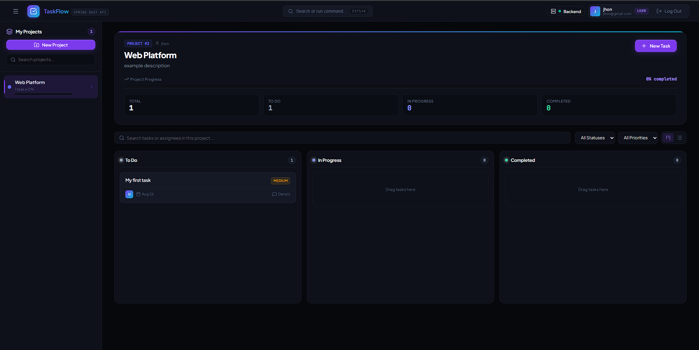
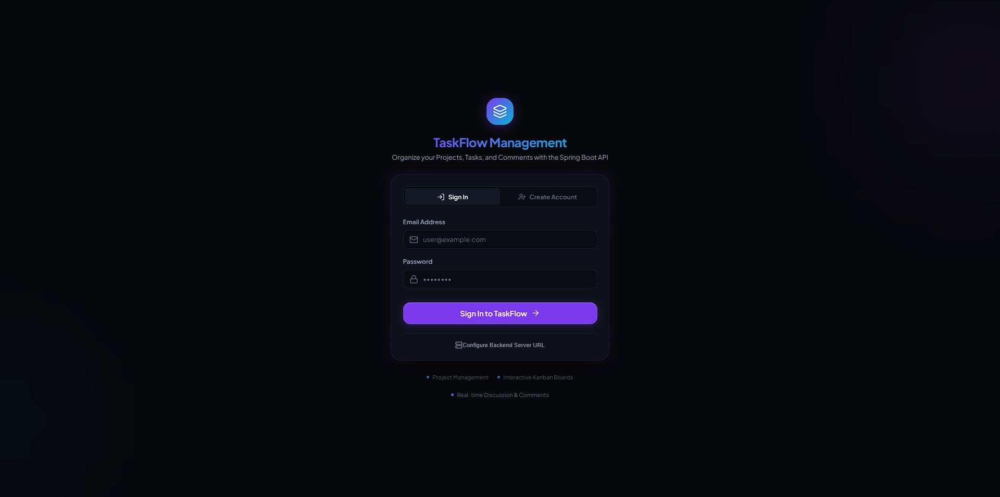
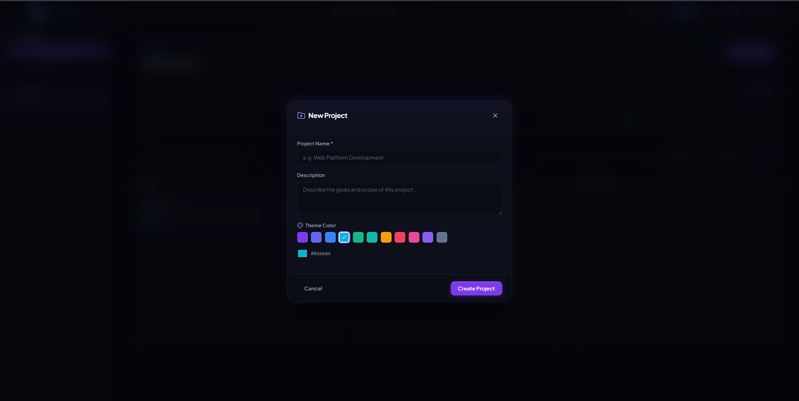
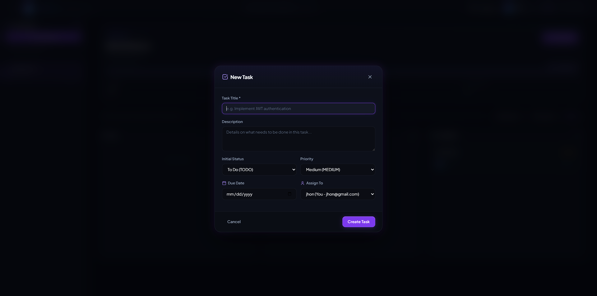
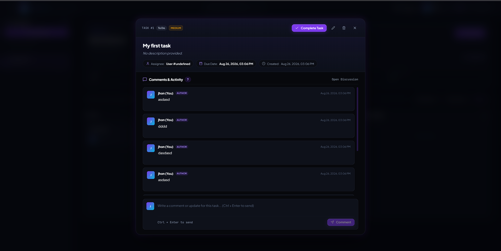

# task-management-demo-ui

A modern, interactive frontend dashboard built with **React** and **Vite**, designed as a demo client for the `task-management-api` backend (Spring Boot task management API with JWT authentication, CRUD operations, and relational persistence).

---

> [!CAUTION]
> ### ⚠️ AI-Generated Disclaimer & Notice
> 
> - **AI-Built Project**: This frontend codebase was generated with AI assistance with minimal human supervision and without strict professional enterprise engineering standards.
> - **Non-Production**: This project **is not, and will never be, intended for production environments**.
> - **Use at Your Own Risk**: The primary objective was simply to deliver a working demo that functions without obvious bugs at first glance. Anyone who uses or adapts this code does so entirely **under their own responsibility and risk**.

---

## 📸 Screenshots & UI Preview

### 📊 Dashboard & Kanban Board


### 🔐 Authentication Flow


### 📁 Project Creation


### 📋 Task Creation


### 💬 Task Discussion & Comments


---

## 🚀 Features

- **🔐 Authentication & User Roles**: Sign Up and Sign In flows with JWT Bearer tokens and automatic token refresh handling. Supports `USER` and `ADMIN` roles.
- **📁 Projects Workspace**: Create, edit, and organize multiple projects with custom theme colors.
- **📋 Kanban & List Views**: Interactive Kanban board with drag-and-drop task progression (`To Do`, `In Progress`, `Completed`) and tabular list view.
- **💬 Task Details & Discussion Thread**: Full task view with metadata (assignee, due dates, priority) and interactive real-time commenting.
- **⚡ Command Palette (`Ctrl + K`)**: Quick search and keyboard navigation for projects and system actions.
- **⚙️ Configurable Backend Connection**: Integrated proxy to Spring Boot backend (`http://localhost:8080`) with support for custom backend base URLs.

---

## 🛠️ Tech Stack

- **Framework**: React 19
- **Build Tool**: Vite
- **Icons**: Lucide React
- **Styles**: Modern Vanilla CSS (Design system with glassmorphism, responsive grid, and dark mode aesthetics)
- **Linter**: Oxlint

---

## 📦 Getting Started

### Prerequisites

- **Node.js**: v18 or higher recommended
- **Package Manager**: npm / pnpm / yarn
- **Backend**: An active instance of `task-management-api` running (default: `http://localhost:8080`)

### Installation & Run

1. Clone the repository and navigate to the folder:
   ```bash
   git clone <repo-url>
   cd task-management-demo-ui
   ```

2. Install dependencies:
   ```bash
   npm install
   ```

3. Start the development server:
   ```bash
   npm run dev
   ```

4. Open your browser at [http://localhost:5173](http://localhost:5173).

---

## 🔌 Connecting to the Backend

By default, Vite proxies requests to:
```
/api  -> http://localhost:8080/api
/auth -> http://localhost:8080/auth
```

If your backend is running on a different port or host, you can:
- Click the **Backend** button in the top navigation bar to configure the Base URL directly in the UI.
- Test the connection using the built-in ping tester.

---

## 📜 License & Usage

This project is provided as an open educational demo "as-is" under no warranty.
